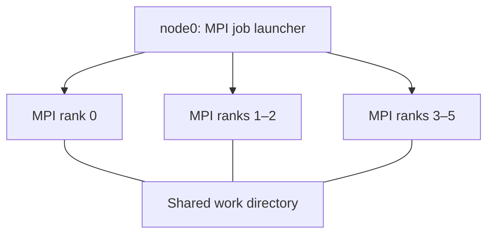

# SCx61 Week 2 — MPI Deadlock Debugging

## Overview

This repository documents the E2 bonus experiments for the SCx61 Distributed Computing Lab. The objective is to investigate how image size affects a naive MPI halo-exchange implementation, diagnose communication-related hangs, and verify a corrected implementation.

The experiments compare a naive blocking communication pattern with a corrected implementation using `MPI.Sendrecv`.

## Objectives

- Investigate how image width affects MPI program completion.
- Investigate possible deadlock behavior in blocking point-to-point communication.
- Test diagnostic hypotheses related to network connectivity and SSH access.
- Verify the corrected implementation against a serial reference.
- Document the experiments, observations, and limitations.

## Environment

| Component | Configuration |
|---|---|
| MPI implementation | Open MPI 4.1.4 |
| Python communication library | `mpi4py` |
| Parallel environment | Docker Compose cluster |
| Cluster nodes | `node0`, `node1`, `node2` |
| MPI processes | 6 ranks |
| Image type | Synthetic grayscale |
| Image height | 300 pixels |
| Timeout per width test | 10 seconds |

## Repository Structure

```text
SCx61-Week2-MPI-Debugging/
├── config/
│   └── compose.yaml
├── source_code/
│   ├── Dockerfile
│   └── entrypoint.sh
├── results/
│   ├── naive_mpi_width_sweep_1.png
│   └── naive_mpi_width_sweep_2.png
├── img_mpi_v2_halo.py
├── make_test_image.py
├── EXTENSION.md
├── INCIDENT.md
├── AI_LOG.md
├── KNOWLEDGE_CHECK.md
├── .gitattributes
├── .gitignore
└── README.md
```

Four selected input images are also included in the repository root. The screenshots in `results/` document the naive MPI width-sweep experiment.

The `config/` and `source_code/` directories contain the course lab's cluster configuration files, retained for reproducibility.

## Cluster Architecture



The cluster consists of three Docker containers connected through the lab network. MPI processes communicate across the cluster, while the shared work directory provides access to input files and experiment outputs.

## Experiment 1: Image Width and Completion

The naive blocking halo-exchange implementation was tested using six MPI ranks and a 10-second timeout per run.

### Results

| Image width | Exit code | Observation |
|---:|---:|---|
| 256 | 0 | Completed |
| 1024 | 0 | Completed |
| 2048 | 0 | Completed |
| 2560 | 0 | Completed |
| 3072 | 0 | Completed |
| 3584 | 0 | Completed |
| 3840 | 0 | Completed |
| 3904 | 0 | Completed |
| 3968 | 0 | Completed |
| 4000 | 0 | Completed |
| 4032 | 0 | Completed |
| 4040 | 0 | Completed |
| 4042 | 124 | Timed out |
| 4044 | 124 | Timed out |
| 4046 | 124 | Timed out |
| 4048 | 124 | Timed out |
| 4056 | 124 | Timed out |
| 4060 | 124 | Timed out |
| 4064 | 124 | Timed out |
| 4096 | 124 | Timed out |
| 8192 | 124 | Timed out |

**Interpretation:** In this environment, the observed transition was between widths 4040 and 4042. Exit code `124` indicates that the `timeout` command reached its time limit. It does not, by itself, prove the precise cause of the hang.

The results are consistent with a possible deadlock associated with the naive blocking communication pattern. The observed transition is environment-specific and should not be treated as a universal MPI message-size threshold.

### Experiment Evidence

The following screenshots contain terminal output from the width-sweep tests:

- `results/naive_mpi_width_sweep_1.png`
- `results/naive_mpi_width_sweep_2.png`

## Experiment 2: Corrected Halo Exchange

The corrected implementation uses `MPI.Sendrecv` to exchange halo rows between neighboring MPI processes.

The implementation was tested using an image of size **8192 × 300** and compared against a serial reference.

### Verification Results

| Check | Result |
|---|---|
| `np.array_equal` | `True` |
| Differing pixels | `0 / 2457600` |
| Verification outcome | Exact match |

The parallel output matched the serial reference for this test, with zero differing pixels.

## Experiment 3: Open MPI Eager-Limit Test

An additional experiment changed the Open MPI eager-limit configuration.

- The 8192-wide test completed with the adjusted configuration.
- The 20000-wide test still timed out.

This configuration change did not provide a general solution in the tested environment. It is an experimental observation, not a recommended universal fix.

## Diagnostic Checks

Two alternative explanations were investigated:

- **DNS and network connectivity:** Name resolution and ping checks succeeded for `node1` and `node2`, with no packet loss during the recorded checks.
- **SSH access:** The command `ssh node1 hostname` returned `node1`, confirming that the tested SSH connection worked.

These checks weakened the hypotheses that basic network connectivity or SSH access caused the observed hang. They do not independently prove the exact MPI deadlock mechanism.

## Reproducibility and Requirements

The experiments were conducted in the SCx61 Week 2 Docker environment.

Requirements include:

- Docker and Docker Compose
- Python
- NumPy
- Pillow
- `mpi4py`
- Open MPI
- The lab's host configuration and required reference scripts

### Run the Corrected Implementation

Start the lab's Docker Compose cluster using the course-provided configuration and ensure that all three nodes are healthy. Then open a shell in `node0` and move to the shared working directory.

Example commands, assuming the cluster is already running and the files are available in `/home/student/work`:

```bash
cd /home/student/work
python3 make_test_image.py --width 8192 --height 300 --out-prefix test_8192
mpirun --hostfile hostfile -n 6 python3 img_mpi_v2_halo.py test_8192 test_8192_out
```

The exact arguments accepted by the image-processing script depend on the lab version. Use the course-provided verification script and reference-image procedure to compare the parallel output against the serial result. Do not interpret a successful process exit alone as proof of pixel-level correctness.

The naive implementation used for the width-sweep experiment belongs to the lab's Break Kit and is intentionally not included in this public repository.

Results may vary with MPI configuration, system resources, and execution environment.

## Conclusion

The width-sweep experiment showed that the naive implementation completed at width 4040 but timed out at width 4042 in the tested environment. The corrected implementation passed the 8192 × 300 serial-reference comparison with zero differing pixels.

The experiments highlight the importance of diagnosing communication behavior, testing across different input sizes, and validating parallel output against a trusted reference.

## Documentation

- `EXTENSION.md` — additional experiment results and analysis.
- `INCIDENT.md` — incident investigation and diagnostic hypotheses.
- `AI_LOG.md` — disclosure of AI assistance and how it was used.
- `KNOWLEDGE_CHECK.md` — MPI concepts and experiment-related questions.

## AI Usage Disclosure

AI assistance was used to help explain MPI communication concepts, organize diagnostic hypotheses, and structure the experiment documentation. Experimental commands and recorded outputs were used as the basis for the conclusions. AI-generated explanations were treated as hypotheses to evaluate rather than as experimental evidence.
